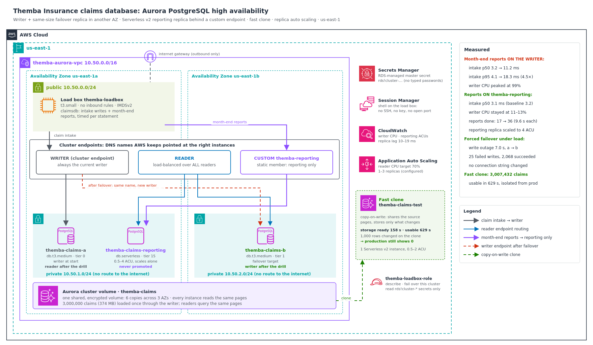

# Aurora High Availability: read isolation, measured failover and fast clones for a claims database

Themba Insurance takes new claims all day through one PostgreSQL database. At every month-end, finance runs heavy reporting queries (totals, averages and 95th-percentile claim values per day and status) against **that same database**. For three month-ends in a row the reports pinned the CPU, claim submissions that normally take a few milliseconds slowed right down, the call centre's screens froze, and brokers gave up and phoned claims in. Separately, when the database host was patched last quarter, the "failover" broke the intake app for over a minute, and nobody could say exactly how long.

I rebuilt the database as an **Aurora PostgreSQL cluster**: a writer, a same-size failover replica in a second Availability Zone, and a **Serverless v2 reporting replica** that finance reaches through its own **custom endpoint**. Then I measured the problem and the fix with a load tool I wrote, which runs inside the VPC.

**Headline results** (same claim intake, same 4 month-end reports looping for 90 seconds):

| | Reports on the writer (the old way) | Reports on `themba-reporting` |
|---|---|---|
| Claim intake p50 | 3.2 → **11.2 ms** | 3.2 → **3.1 ms** |
| Claim intake p95 | 4.1 → **18.3 ms** (4.5×) | 4.0 → **6.0 ms** |
| Writer CPU (1-minute peak) | **99%** | **11–13%** |
| Reports completed in 90 s | 17 (18.8 s each) | **36 (9.6 s each)** |
| Intake errors | 0 | 0 |

- **Forced failover under load: writes stopped for 7.0 seconds**, measured from the application's side. The writer moved from `us-east-1a` to `us-east-1b`, and the application never changed its connection string.
- **The reporting replica scaled itself** from 1.5 to its 4 ACU ceiling while the reports ran on it, and stayed low (1.5–2.5 ACU) while they ran on the writer.
- **A full-size, writable test copy (3,007,432 claims) was usable in 629 seconds** as a copy-on-write clone. 1,000 rows changed on the clone; production still showed 0.
- **No password was typed, and no port was opened to the internet.** RDS keeps the master password in Secrets Manager, the database accepts connections only from the load box's security group, and I reached the load box through Session Manager.
- Built, measured and torn down in one morning.



---

## The problem I was solving

> Month-end reporting must never slow down claims intake. The database must survive losing its primary with a short, **measured** outage. Reporting load is spiky (quiet for 28 days, brutal for 2), so its capacity should follow demand instead of being paid for all month. And the test team needs a production-sized copy without a multi-hour restore.

This continues the Themba Insurance story: `aws-multi-region-dr-failover` covered losing a whole Region, and `aws-private-connectivity-endpoints` kept its traffic off the internet. This project deals with the database inside one Region, where most real outages and slowdowns happen.

---

## Four ideas the whole build depends on

1. **In Aurora, storage and compute are separate.** The cluster owns one shared volume (six copies across three AZs). Instances are compute attached to it. A new reader has no data to copy; it reads the same pages the writer wrote. That's why a count on a reader returned all 3,000,000 claims less than a minute after the load finished, with nothing copied.
2. **Endpoints are the contract with applications.** The *writer* endpoint always points at the current writer, the *reader* endpoint spreads connections over all readers, and a *custom* endpoint points at exactly the instances I choose. Applications use names, never instance hostnames, so a failover or a new replica needs no application change.
3. **Promotion tiers decide who becomes the writer.** The lowest tier wins. The failover target is tier 1. The reporting replica is tier 15, so it's never promoted, and a Serverless v2 reader in tiers 2–15 scales on **its own** load rather than following the writer's size.
4. **A clone isn't a copy.** A copy-on-write clone shares the source's storage pages and only stores pages that change on either side. Its readiness depends on creating an instance, not on how much data there is.

---

## Architecture decisions

| Requirement | Decision | Why |
|---|---|---|
| Reports must not touch intake | **Custom endpoint `themba-reporting`** with one static member: the reporting replica | The built-in reader endpoint would also send reports to the failover target |
| Spiky month-end load | Reporting replica on **Aurora Serverless v2** (0.5–4 ACU) | Capacity follows the load: 1.5 ACU between bursts, 4 ACU while the reports ran on it |
| Reporting replica must never become the writer | **Promotion tier 15** | Lowest tier wins a failover; tier 15 is last, and it scales independently |
| Short, predictable failover | **Same-size reader in a second AZ, tier 1** | After a failover the new writer is as big as the old one, in a different AZ |
| Test copy without a long restore | **Copy-on-write fast clone** with its own small Serverless v2 instance | Shares pages with production; changes stay on their own side |
| Readers grow with read load | **Application Auto Scaling** on `RDSReaderAverageCPUUtilization`, target 70%, 1–3 replicas | Guardrail for the general reader endpoint (dashboards, new apps) |
| No passwords anywhere | **RDS-managed master secret** (`--manage-master-user-password`) | The password never appears on screen, in a file or in shell history |
| Nothing reachable from outside | Private DB subnets with no internet route; DB security group allows **5432 from the load box's security group only**; Session Manager instead of SSH | No inbound rule on the load box, no open port, no key pair |
| Encrypted at rest and in transit | `--storage-encrypted`; every connection uses `sslmode=require` | Claims hold policyholder personal information |

I also compared Aurora with RDS Multi-AZ (one standby instance, or a Multi-AZ DB cluster with two readable standbys). The comparison and the reasons I chose Aurora are in [ADR 0001](docs/adr/0001-aurora-cluster-over-rds-multi-az.md). Long-form reasoning for every decision is in [`docs/adr/`](docs/adr). The diagram uses the **official AWS Architecture Icons** and is generated from [`docs/diagram/build_architecture.py`](docs/diagram/build_architecture.py). The icon pack itself isn't committed: AWS licenses it for diagrams, not redistribution.

---

## How I measured it

The database is private, so the measuring has to happen inside the VPC. I wrote [`loadbox/claimsdb.py`](loadbox/claimsdb.py), a Python tool that runs on a small EC2 load box. It discovers the cluster's endpoints and the managed secret itself, through the AWS CLI and the instance role, so no hostname or password is ever typed.

| Command | What it measures |
|---|---|
| `claimsdb whoami <endpoint>` | Which instance answers an endpoint, and whether it's the writer (`pg_is_in_recovery()`) |
| `claimsdb seed --rows 3000000` | Loads realistic claims in 500,000-row batches, then `ANALYZE` |
| `claimsdb impact --report-to <endpoint>` | Writes a claim about every 50 ms through the **writer** and times each one. From 30 s to 120 s, 4 month-end reports loop on the chosen endpoint. Prints p50/p95/max per 5-second window, then a phase summary with p99 |
| `claimsdb failover-drill --target <instance>` | Keeps writing claims, calls `failover-db-cluster` at 20 s, and reports the longest gap between successful writes: the outage the application actually felt |
| `claimsdb --cluster <id> sql …` | The same tool against another cluster (the clone) |

Every run saved its raw samples as CSV on the load box ([`24`](docs/screenshots/24-step12-raw-results-listing.png)). The boot script that installs the tool is built by [`scripts/build_userdata.py`](scripts/build_userdata.py), which embeds the tool gzip-compressed and base64-encoded: 8,154 bytes, inside EC2's 16 KB user-data limit.

---

## What I proved

| Test | Result | Evidence |
|---|---|---|
| Engine version checked, not hard-coded | ✅ Default `aurora-postgresql` 17.9; both planned classes orderable in the Region (the per-AZ check came later: see debugging) | [`01`](docs/screenshots/01-step0-engine-version-and-orderable-checks.png) |
| Network: private DB subnets, SG-to-SG rule | ✅ 5432 allowed only from the load box SG | [`02`](docs/screenshots/02-step1-vpc-subnets-gateway-route.png), [`03`](docs/screenshots/03-step1-security-groups-db-from-loadbox-only.png) |
| Cluster topology | ✅ a (tier 0, writer, 1a), b (tier 1, 1b), reporting (Serverless v2, tier 15, 1a) | [`07`](docs/screenshots/07-step4-three-instances-tiers-and-classes.png) |
| Shared storage | ✅ 3,000,000 claims (374 MB) loaded in 55 s; a reader counted all 3,000,000 immediately | [`08`](docs/screenshots/08-step6-seed-3m-claims-and-endpoint-routing.png) |
| Endpoint routing | ✅ writer → a; reader → b ×4 and reporting ×2; `themba-reporting` → reporting 3 of 3 | [`08`](docs/screenshots/08-step6-seed-3m-claims-and-endpoint-routing.png) |
| **The trap: reports on the writer** | ✅ intake p95 4.1 → 18.3 ms; writer CPU 99%; 17 reports at 18.8 s | [`09`](docs/screenshots/09-step7-reports-on-writer-live.png), [`10`](docs/screenshots/10-step7-reports-on-writer-summary.png), [`13`](docs/screenshots/13-step8-writer-cpu-cloudwatch.png) |
| **The fix: reports on `themba-reporting`** | ✅ intake p50 3.1 ms (baseline 3.2); writer CPU 11–13%; 36 reports at 9.6 s | [`11`](docs/screenshots/11-step8-reports-on-reporting-endpoint-live.png), [`12`](docs/screenshots/12-step8-reports-on-reporting-endpoint-summary.png), [`13`](docs/screenshots/13-step8-writer-cpu-cloudwatch.png) |
| Serverless v2 followed the load | ✅ 1.5 → 4.0 ACU during the fix run; replica lag 10–19 ms | [`14`](docs/screenshots/14-step8-reporting-replica-acus-cloudwatch.png)–[`16`](docs/screenshots/16-step8-console-acu-utilization.png) |
| **Failover under load** | ✅ **7.0 s** write outage, 25 failed writes, 2,068 succeeded; writer a → b | [`17`](docs/screenshots/17-step9-failover-drill-live.png), [`18`](docs/screenshots/18-step9-failover-summary-7s-outage.png) |
| AWS's own record agrees | ✅ "Started cross AZ failover" 06:29:15.5 → "Completed" 06:29:26.9 UTC; b is writer | [`19`](docs/screenshots/19-step9-members-after-failover-and-rds-events.png) |
| Endpoints followed the writer | ✅ writer → b; `themba-reporting` still → reporting | [`20`](docs/screenshots/20-step9-endpoints-follow-new-writer.png) |
| **Fast clone** | ✅ storage ready in 158 s, usable in 629 s; 3,007,432 claims | [`21`](docs/screenshots/21-step10-fast-clone-timings.png), [`22`](docs/screenshots/22-step10-clone-isolation-queries.png) |
| Clone isolation | ✅ 1,000 rows changed on the clone → clone 1,000, production 0 | [`22`](docs/screenshots/22-step10-clone-isolation-queries.png) |
| Replica auto scaling | ✅ Scalable target registered (min 1, max 3); target-tracking policy from [`replica-autoscaling.json`](templates/replica-autoscaling.json) (reader CPU 70%); configured, not load-tested | [`23`](docs/screenshots/23-step11-replica-auto-scaling-target.png) |
| Teardown | ✅ clean check re-run with corrected quoting: clusters, instances, snapshots, secrets, load box, VPC and role all empty | [`26`](docs/screenshots/26-step13-clean-check-rerun.png) (first attempt: [`25`](docs/screenshots/25-step13-clean-check.png)) |

**Build evidence:** load box role, boot script and launch ([`04`](docs/screenshots/04-step2-loadbox-role-userdata-launch.png)); subnet group and encrypted cluster with a managed master password ([`05`](docs/screenshots/05-step3-subnet-group-and-cluster.png)); load box running with both status checks OK ([`06`](docs/screenshots/06-step3-loadbox-running-checks-ok.png)).

The 3,007,432 in the clone is a check in itself: 3,000,000 seeded claims plus exactly the 7,432 intake writes from the three drills (2,571 + 2,793 + 2,068). The clone captured everything committed up to its restore point.

Walkthroughs: [`docs/read-isolation.md`](docs/read-isolation.md), [`docs/failover-drill.md`](docs/failover-drill.md), [`docs/fast-clone.md`](docs/fast-clone.md).

---

## The failover, second by second (UTC)

| Time | Seconds into drill | What happened |
|---|---|---|
| 06:29:04 | 20.8 | `failover-db-cluster` requested, target `themba-claims-b` |
| 06:29:15.5 | ~32 | AWS event: *Started cross AZ failover to DB instance: themba-claims-b* |
| 06:29:21 | 37.9 | Last successful write on `themba-claims-a` |
| 06:29:26.9 | ~44 | AWS event: *Completed customer initiated failover* |
| 06:29:28 | 44.9 | First successful write on `themba-claims-b` |

The application kept writing normally for about 17 seconds after the request, while AWS prepared the failover. The outage the app felt was **7.0 seconds**. The first write on the new writer landed about a second after AWS reported the failover complete, consistent with the writer endpoint's DNS record moving to `themba-claims-b`. The errors were `SSL SYSCALL error: EOF detected` and connection failures to the cluster endpoint. Those are exactly what a production application's retry logic has to handle, and now Themba knows it needs to ride out roughly 7–10 seconds, not "over a minute". Details: [`docs/failover-drill.md`](docs/failover-drill.md).

---

## Debugging along the way

- **The instance class I planned wasn't offered where my subnets were.** Creating the writer as `db.t4g.medium` failed with `InvalidVPCNetworkStateFault`. Listing the orderable AZs showed that, for Aurora PostgreSQL 17.9, `db.t4g.medium` was offered only in `us-east-1f`, while `db.t3.medium` was offered in all six. My pre-check had only counted offerings in the Region, so it passed. I switched both provisioned instances to `db.t3.medium` (same 2 vCPU / 4 GiB) to keep the two-AZ failover design, rather than moving everything into one AZ.
- **I chained the create and the wait with `&&`.** The first failure had also produced a confusing `DBInstanceNotFound` from the waiter, which ran after a create that never happened. From then on the wait only ran if the create succeeded.
- **A `!` threw away my first clean check.** Bash treats `!` inside double quotes as history expansion, so `starts_with(Name,'rds!cluster')` became `event not found`, and because I'd run the seven queries as one block, bash rejected the whole block: none of them ran. I re-ran it with single quotes around that query.
- **I lined up two clocks.** The load tool prints UTC; the CLI printed CloudWatch times in my local time (UTC+2). Writer CPU's 99% at 08:14 local is the reports-on-writer run at 06:12–06:14 UTC.
- **I didn't overclaim the fix.** The fix run's p95 is 6.0 ms, not 4.0, because two of eighteen 5-second windows spiked (21.5 ms and 43.7 ms). The median and the other sixteen windows matched the baseline. I report the number as measured.

Full notes: [`docs/debugging-journey.md`](docs/debugging-journey.md).

---

## Cost

Unlike most of my builds, this one **bills by the hour while it exists**, so I built, measured and tore it down in one sitting.

| Item | Rate (us-east-1 list price, approx.) | Usage |
|---|---|---|
| 2 × `db.t3.medium` Aurora PostgreSQL | ~US$0.08 per instance-hour | ~1 hour each |
| Serverless v2 reporting replica | US$0.12 per ACU-hour | 1.5–4 ACU for ~1 hour |
| Clone instance (Serverless v2) | US$0.12 per ACU-hour | 0.5–2 ACU for ~20 minutes |
| Load box `t3.small` + public IPv4 | ~US$0.03 per hour | ~1.5 hours |
| Storage and I/O (3M rows, drills) | per GB-month / per million requests | cents |
| **Total (estimate)** | | **about US$1–2** |

Left running, the same cluster would cost roughly US$10 a day, which is why teardown was part of the plan. Cost Explorer lags by up to 24 hours, so the final figure shows the next day. At Themba's real size, and why Serverless v2 is the cheap way to buy month-end headroom: [`docs/cost-model.md`](docs/cost-model.md).

---

## Compliance & frameworks

An insurer's claims database holds policyholders' personal information, and its availability is a regulatory expectation, not just good engineering. This build maps to:

- **POPIA §19 (South Africa)**: appropriate technical measures to protect the integrity and confidentiality of personal information. Encryption at rest and in transit, private subnets, least-privilege access and no stored passwords.
- **Prudential Authority / FSCA Joint Standards for insurers** (IT governance and risk management; cybersecurity and cyber resilience): resilient, tested systems and documented recovery capability. The failover drill is a measured recovery test, not an assumption.
- **ISO/IEC 27001:2022 Annex A**
  - **A.8.14 Redundancy of information processing facilities**: a writer and a same-size standby in two AZs over 3-AZ storage.
  - **A.5.30 ICT readiness for business continuity**: a failover exercised under load, with a measured outage.
  - **A.8.6 Capacity management**: Serverless v2 for reporting, plus reader auto scaling.
  - **A.8.31 Separation of development, test and production**: the test team works on a clone that can't touch production.
  - **A.8.33 Test information**: a clone of production holds real personal data. In real use it gets the same access controls as production, or masking before handover.
  - **A.8.24 Use of cryptography** and **A.5.17 Authentication information**: TLS on every connection, an encrypted volume, and an RDS-managed master secret.
  - **A.8.20 Networks security**: SG-to-SG rules and no internet route to the database.
- **NIST SP 800-53 Rev. 5**
  - **CP-4** contingency plan testing (the drill) and **CP-10** system recovery and reconstitution.
  - **SC-7** boundary protection.
  - **SC-8** transmission confidentiality and **SC-28** protection of information at rest.
  - **IA-5** authenticator management (managed, rotatable secret).
  - **AC-6** least privilege: the load box may describe, fail over only this cluster, and read only RDS-managed secrets.
- **NIST Cybersecurity Framework 2.0**
  - **PR.IR-03**: mechanisms to achieve resilience requirements in normal and adverse situations.
  - **PR.IR-04**: adequate resource capacity to ensure availability.
  - **PR.DS-01 / PR.DS-02**: data at rest and in transit protected.
  - **PR.AA-05**: least-privilege access.
  - **ID.IM-02**: improvements identified from tests and exercises (the 7-second number feeds the app's retry policy).
- **SOC 2 (AICPA Trust Services Criteria)**
  - **A1.1** capacity, **A1.2** recovery infrastructure and **A1.3** recovery testing.
  - **CC6.1 / CC6.7**: logical access and protection of data in transmission.

---

## Repo layout

```
.
├── README.md
├── env.sh.example                    # copy to env.sh (git-ignored); saved IDs + the save() helper
├── loadbox/
│   ├── claimsdb.py                   # the measuring tool: whoami, seed, sql, impact, failover-drill
│   └── userdata.sh.tpl               # load box boot script: psycopg2 + claimsdb (embedded at build time)
├── scripts/
│   ├── build_userdata.py             # embeds claimsdb (gzip + base64), refuses anything over 16 KB
│   ├── render.py                     # fills @@NAME@@ placeholders; refuses to leave any empty
│   └── kit_aws.py                    # shared helper (repo-relative paths)
├── policies/
│   ├── ec2-trust.json                # the load box role's trust policy
│   └── loadbox-perms.json.tpl        # describe; fail over THIS cluster; read rds!cluster-* secrets only
├── templates/
│   └── replica-autoscaling.json      # target tracking: reader CPU 70%
└── docs/
    ├── architecture.png / .svg       # official AWS Architecture Icons
    ├── diagram/                      # build_architecture.py + awsdiag.py
    ├── read-isolation.md
    ├── failover-drill.md
    ├── fast-clone.md
    ├── debugging-journey.md
    ├── cost-model.md
    ├── teardown.md
    ├── adr/                          # 7 architecture decision records
    └── screenshots/                  # 26 build, drill and teardown screenshots, in order
```

> **No account IDs are committed.** Templates use `@@NAME@@` placeholders filled at run time, and account IDs are masked in the screenshots. There is no `Deny` statement anywhere in the project, and no resource has deletion protection, so teardown can't lock anyone out.

---

## Reproduce it

From WSL, in `us-east-1`, as an administrator:

1. From the repo folder: `cp env.sh.example env.sh && mkdir -p build && source env.sh`
2. Save `ACCOUNT_ID` and `PG_VERSION` (`describe-db-engine-versions --default-only`). For each instance class, **list the orderable AZs** and compare them with the AZs you'll use.
3. VPC `10.50.0.0/16`: public subnet (1a) with an internet gateway route; private subnets (1a, 1b) with none. Security groups: load box (no inbound) and DB (5432 from the load box SG).
4. Load box: role from `ec2-trust.json` + `loadbox-perms.json.tpl` + `AmazonSSMManagedInstanceCore`; `python3 scripts/build_userdata.py`; launch a `t3.small` AL2023 instance with IMDSv2 and `build/userdata.sh`.
5. Subnet group; cluster with `--manage-master-user-password --storage-encrypted --serverless-v2-scaling-configuration MinCapacity=0.5,MaxCapacity=4`; then writer `themba-claims-a` (tier 0, 1a).
6. `themba-claims-b` (same class, 1b, tier 1) and `themba-claims-reporting` (`db.serverless`, tier 15); custom endpoint `themba-reporting` with `--static-members themba-claims-reporting`.
7. On the load box (Session Manager): `claimsdb seed`, `claimsdb whoami …`, `claimsdb impact --report-to writer`, `claimsdb impact --report-to themba-reporting`.
8. `claimsdb failover-drill --target themba-claims-b`, then `describe-events`.
9. `restore-db-cluster-to-point-in-time --restore-type copy-on-write` + one `db.serverless` instance; the clone isolation queries.
10. `register-scalable-target` + `put-scaling-policy` with `templates/replica-autoscaling.json`.
11. Teardown the same day: [`docs/teardown.md`](docs/teardown.md).

---

## What this connects to

- `aws-multi-region-dr-failover`: Themba's Region-level recovery. This project is the in-Region layer underneath it. Aurora Global Database is the natural next step to join the two.
- `aws-private-connectivity-endpoints`: the same principle of keeping traffic private. Here the database has no internet route at all, and I reach the load box without SSH.
- `aws-decoupled-order-pipeline`: that project isolated slow consumers with queues. This one isolates slow readers with endpoints. Same idea, different layer.
- `aws-cloudtrail-config-governance`: every `failover-db-cluster` and `restore-db-cluster-to-point-in-time` call is an API event that trail records: who failed over production, and when.
